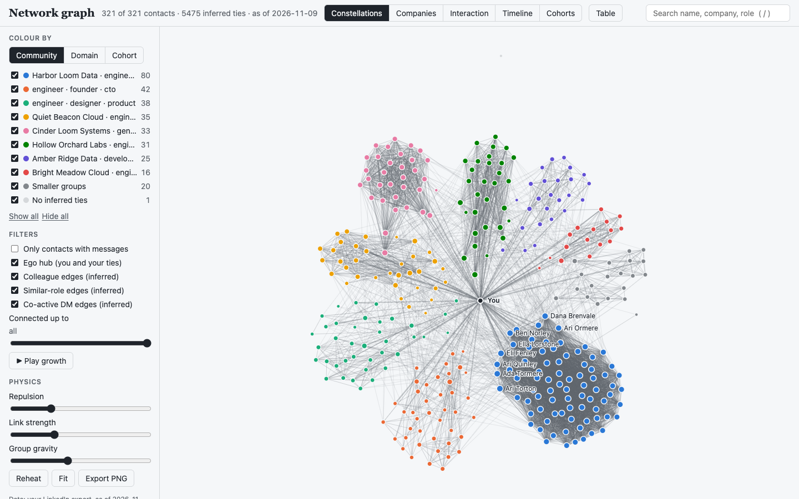
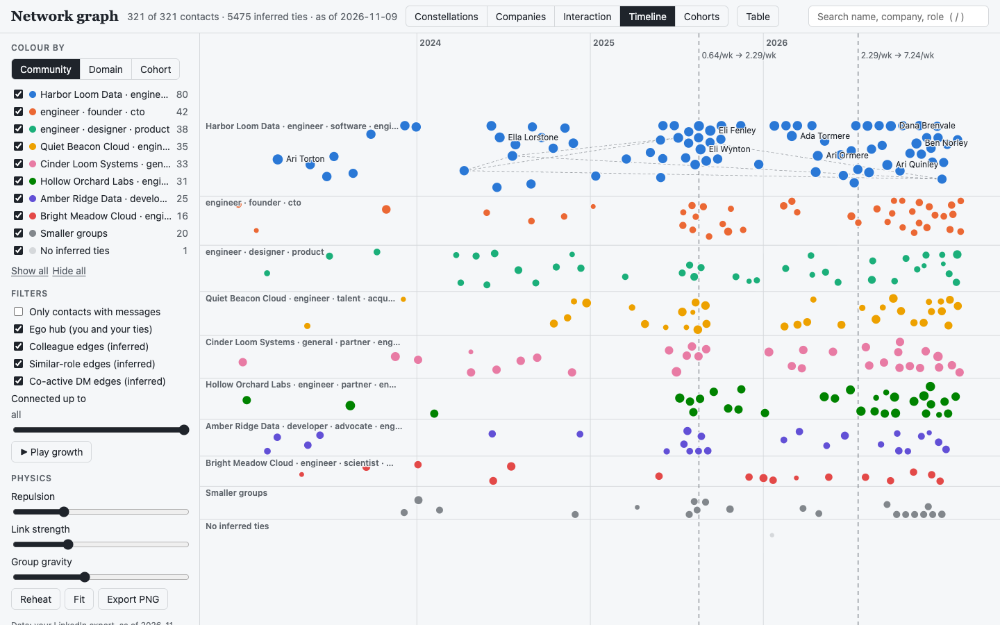
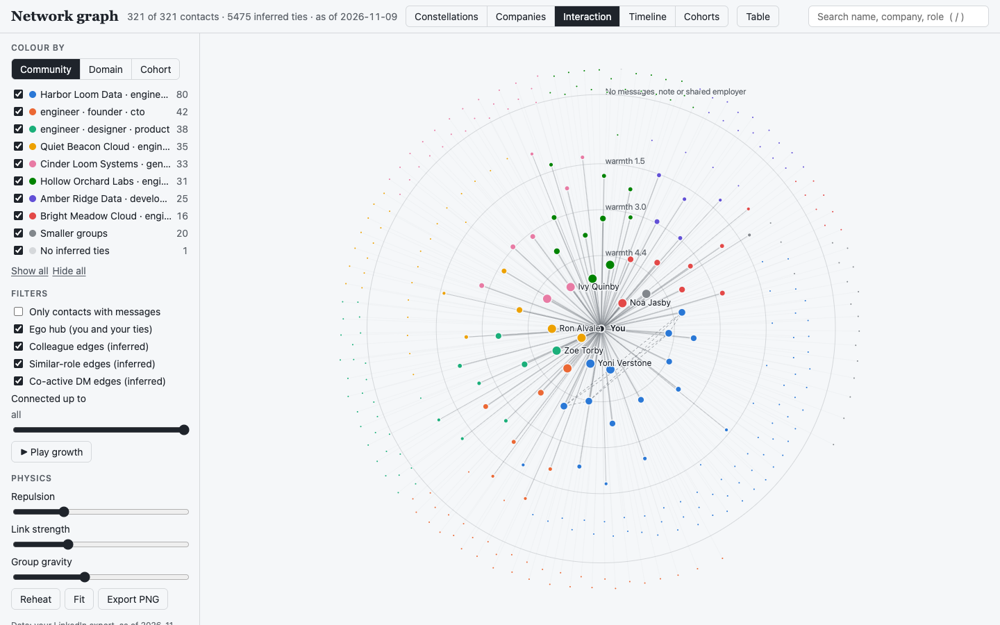

# tiegraph

**TL;DR:** download your LinkedIn data export, run one command, and get an interactive map of your
network in a single HTML file. It runs on your computer, with no account, no server and no uploads.

<picture>
  <source media="(prefers-color-scheme: dark)" srcset="docs/screenshots/constellations-dark.png">
  
</picture>

<sub>Screenshots use a synthetic export: every person and company in them is invented.</sub>

## From zero to your graph in 3 steps

**1. Ask LinkedIn for your data.**
Open [Get a copy of your data](https://www.linkedin.com/mypreferences/d/download-my-data) (sign in if asked),
choose either option, and press **Request archive**.
LinkedIn's own help page: [Download your data](https://www.linkedin.com/help/linkedin/answer/a1339364).
→ You get an email when it is ready: minutes for the first option, up to a day for the larger one. Both work.

**2. Download the ZIP.**
Follow the link in that email and download the file.
→ A file like `Basic_LinkedInDataExport_11-12-2026.zip` is in your Downloads folder. Leave it zipped.

**3. Run one command.**
With [uv](https://docs.astral.sh/uv/getting-started/installation/) installed, paste this into a terminal
(or type the first part and drag the ZIP onto the terminal window to fill in its path):

```bash
uvx --from git+https://github.com/chernistry/tiegraph tiegraph build ~/Downloads/Basic_LinkedInDataExport_*.zip --open
```

→ It prints something like `321 contacts · 10 communities · 70 you messaged · 2 connection bursts`
and opens the graph in your browser. The files are in `./tiegraph-out/`: `graph.html` (open it any time,
offline) and `graph.json` (the same data, for your own scripts).

## What you can see

| View | Shows |
|---|---|
| Constellations | Communities of contacts who share employers or similar roles, coloured by group, field or cohort |
| Companies | One hub per employer, sized by how many of your contacts work there |
| Interaction | You in the centre; contacts you talk to most sit closest |
| Timeline | When you connected with each person, one lane per group |
| Cohorts | Bursts of new connections (a conference, a new job), with the weeks your growth rate changed |

Search, filters, a date slider with growth playback, a sortable table and a details panel come with every view.
`graph.html#view=timeline&color=domain` opens a view directly.

<picture>
  <source media="(prefers-color-scheme: dark)" srcset="docs/screenshots/timeline-dark.png">
  
</picture>

<picture>
  <source media="(prefers-color-scheme: dark)" srcset="docs/screenshots/radar-dark.png">
  
</picture>

## Privacy

- Everything stays on your machine. The tool makes no network requests, and the page cannot make any
  either: its Content-Security-Policy blocks every outside connection.
- The output files are readable by your user only. They contain your contacts' names, so keep them
  private, and do not upload `graph.html` anywhere.
- Message text is never read into the output: only who, when and which way.
- Ties between your contacts are **inferred** (same employer, similar job title), not observed:
  the export does not say who knows whom. The page labels them as inferred.

## How it works

The export is read straight from the ZIP into an in-memory [DuckDB](https://duckdb.org/) database.
[NetworkX](https://networkx.org/) finds communities (Louvain), PageRank and betweenness.
Connection bursts come from an exact binomial scan of every 1, 3 and 7-day window against the
growth rate of its period (periods split by CUSUM changepoints), with Benjamini-Hochberg correction;
under a steady rate they appear by chance in under 5% of simulated exports.
The page itself is one HTML file with the data embedded and no external files.

Options: `tiegraph build --help` (`--out`, `--aliases` to merge company name variants, `--db` to keep the database).

An aliases file is a two-column CSV. Every variant on the left is counted as the name on the right:

```csv
variant,canonical
Tidewell Holdings,Tidewell
Tidewell Corp (Tidewell Holdings),Tidewell
```

## Limits

- Only your direct connections are in the export, so ties between them are guesses from employers and titles.
- A contact who changed their profile URL may not be matched to old messages. The tool leaves them
  unmatched rather than guessing by name.
- LinkedIn can change the export format. Tested with exports from November 2026, both the fast and the
  larger archive.

## Development

```bash
uv sync
uv run pytest
uv run ruff check && uv run ruff format --check
uv run python tests/synthetic.py out/export.zip   # a synthetic export of 320 invented people
```

Report security issues privately: see [SECURITY.md](SECURITY.md). Changes: [CHANGELOG.md](CHANGELOG.md).

## Licence

[Apache-2.0](LICENSE).

tiegraph is an independent project. It is not affiliated with, endorsed by or sponsored by LinkedIn.
"LinkedIn" is used only to say which data export the tool reads.
